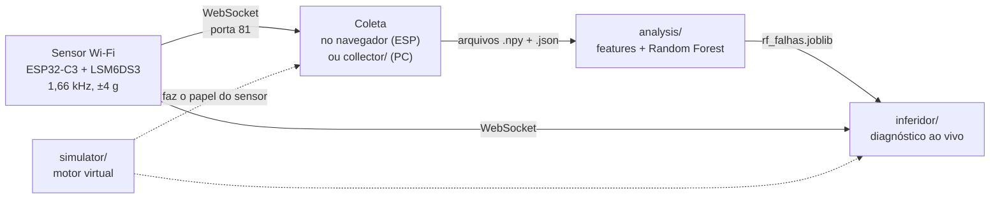

# Detector de falhas em eixo de motor por vibração


Projeto final da disciplina de **Inteligência Artificial** (UFPE, DEE, Prof. Jeydson Lopes da Silva, 2026.2).

Um acelerômetro de 3 eixos preso à carcaça de um motor mede a vibração. Um classificador de aprendizado de máquina
identifica a condição do eixo em tempo real: **parado, normal, desbalanceado (leve ou forte)** e **falhas de montagem**
(parafuso frouxo, calço sob o motor). São só falhas que dá para provocar ao vivo na bancada.

> **Aviso sobre os resultados.** Os números deste README vêm de **dados simulados** e são otimistas. Dados reais do
> motor ainda estão sendo coletados (veja [COLETA.md](COLETA.md)). Quando existirem, o notebook deve ser reexecutado
> sobre eles e os números abaixo substituídos.

## Como funciona



1. **Sensor:** o ESP32-C3 lê a FIFO do LSM6DS3 a ~1,65 kHz e transmite as amostras brutas por Wi-Fi.
2. **Coleta:** o próprio ESP serve a página de coleta (forma de onda, espectro, gravação). Cada gravação vira um par
   `.npy` (int16, `n × 3`) + `.json` (metadados) e pode ir para uma pasta do Google Drive.
3. **Análise:** janelas de 2 s viram ~80 *features* espectrais (amplitude nas ordens 0,5× a 8× da rotação, razões entre
   ordens, curtose, bandas, relação axial/radial). Um Random Forest classifica cada janela.
4. **Inferência ao vivo:** o `inferidor/` recebe o stream do sensor e mostra o diagnóstico numa janela.

## Estrutura do repositório

| Pasta | O que é | Como rodar |
|---|---|---|
| [`firmware/collect/`](firmware/collect) | Firmware do sensor. O ESP é **servidor**: serve a página de coleta (LittleFS) e o stream de amostras. Inclui o envio opcional ao Google Drive. | `pio run -t upload` e `pio run -t uploadfs` |
| [`collector/`](collector) | Coletor alternativo no PC (FastAPI + WebSocket). Mesmo formato de arquivo. | `collector\run.bat` |
| [`simulator/`](simulator) | Simulador de motor com GUI e gerador de dataset sintético. | `simulator\run.bat` |
| [`analysis/`](analysis) | Notebook de análise: *features*, comparação de algoritmos, validação, modelo final. | `analysis\run.bat` |
| [`inferidor/`](inferidor) | Janela que mostra o diagnóstico ao vivo. | `inferidor\run.bat` |
| [`CONTEXT.md`](CONTEXT.md) | Memória técnica do projeto: decisões, medições, armadilhas já resolvidas. | |
| [`COLETA.md`](COLETA.md) | Roteiro passo a passo para a coleta com o motor real. | |

Cada aplicação Python é **independente**: pasta própria, `.venv` e `requirements.txt` próprios, sem importar código das outras.

## Hardware

- **ESP32-C3** (DevKitM-1) e acelerômetro **LSM6DS3** por I2C (SDA = GPIO 8, SCL = GPIO 9, endereço 0x6B).
- Amostragem de 1666 Hz declarados (~1649 Hz entregues, 0 pacotes perdidos em 150 s de teste), escala ±4 g, 0,122 mg/LSB.
- Eixos: X radial horizontal, Y axial, Z radial vertical.

## Início rápido

**Sensor** (precisa do PlatformIO; o `pio` da extensão do VS Code fica em `~/.platformio/penv/Scripts/pio.exe`):

```bash
cd firmware/collect
pio run -t upload      # firmware
pio run -t uploadfs    # interface web (pasta data/) para a flash
```

Depois conecte o celular ou notebook ao Wi-Fi **`sensor-coleta`** (senha em `firmware/collect/include/configuracao.h`)
e abra <http://sensor.local> ou <http://192.168.4.1>. Para ter internet junto (Google Drive), grave o Wi-Fi do roteador
no botão **Rede** da página. Detalhes em [`firmware/collect/README.md`](firmware/collect/README.md) e
[`firmware/collect/drive/LEIA-ME.md`](firmware/collect/drive/LEIA-ME.md).

**Análise e simulação** (sem hardware):

```bash
simulator\run.bat      # motor virtual com interface; gera dados como se fosse o sensor
analysis\run.bat       # abre o JupyterLab em analise.ipynb (já executado)
```

## Classes e metodologia

| Classe | Como é provocada na bancada |
|---|---|
| `parado` | motor desligado |
| `normal` | motor sem falha |
| `desbalanceado_leve` | peso pequeno preso ao eixo |
| `desbalanceado_forte` | peso grande preso ao eixo |
| `folga` | parafuso de fixação frouxo (dataset simulado) |
| `desalinhado` | calço sob um pé do motor (planejado para a coleta real) |

- **Algoritmo:** Random Forest. Desafiantes: regressão logística, SVM-RBF, MLP, Extra Trees, Gradient Boosting. A regra de
  escolha foi fixada antes dos resultados: maior F1-macro em validação por sessão; em empate, o mais simples.
- **Sem deep learning:** poucas sessões independentes (a rede decoraria a montagem do sensor) e as falhas de eixo têm
  assinatura espectral conhecida.
- **Validação *leave-one-session-out*:** uma sessão é uma montagem do sensor. Nunca se divide por janela, senão o
  resultado vaza entre treino e teste.
- **A rotação deve ser informada** (faixa esperada pelo setpoint). Estimá-la só pelo espectro é ambíguo (0,5×/1×/2×).

## Resultados (dados simulados)

75 gravações de 60 s (5 classes × 3 velocidades × 5 sessões), 4125 janelas de 2 s.

| Modelo | F1-macro (média ± desvio entre sessões) |
|---|---|
| **Random Forest** | **0,918 ± 0,108** |
| SVM-RBF | 0,918 ± 0,077 |
| MLP | 0,909 ± 0,104 |
| Regressão logística | 0,903 ± 0,095 |
| Gradient Boosting | 0,895 ± 0,092 |
| Extra Trees | 0,882 ± 0,139 |

- `parado`, `normal` e `folga`: 100 % de acerto. O erro está todo em graduar o peso: `desbalanceado_leve` tem recall de
  0,75 (0,50 em baixa rotação), porque a amplitude do desbalanço cai com ~f⁴ e um peso leve em baixa rotação se confunde
  com o motor saudável.
- O modelo **não extrapola** para velocidade nunca vista (F1 0,48 a 0,67): treinar com todas as velocidades.
- Treinado só com dados limpos, **colapsa com ruído extra** (+15 mg); *augmentation* de ruído recupera (0,88).
- A curva de aprendizado ainda sobe com 4 sessões: na coleta real, **≥ 4–5 sessões com remontagem do sensor**.
- Uma janela de 2 s leva ~30 ms para classificar (1,5 % do tempo real).

## Limitações

- Resultados em **dados simulados**; sem calibração com dados reais ou públicos (candidato: MaFaulDa, UFRJ).
- Apenas 5 sessões simuladas, com desvio grande entre elas.
- Falhas de rolamento ficaram fora do escopo, por não serem reproduzíveis na bancada.
- O firmware atual faz o ESP ser servidor WebSocket; `collector/`, `inferidor/` e `simulator/` ainda esperam o ESP como
  cliente. Veja a seção "Incompatibilidade a resolver" em [CONTEXT.md](CONTEXT.md).
- O envio ao Google Drive foi testado só contra um emulador do Apps Script; o fluxo real depende da senha do usuário.

## Documentação

- [COLETA.md](COLETA.md): roteiro de coleta com o motor real
- [CONTEXT.md](CONTEXT.md): decisões, medições e armadilhas
- [firmware/collect/README.md](firmware/collect/README.md) e [drive/LEIA-ME.md](firmware/collect/drive/LEIA-ME.md): firmware e Google Drive
- [analysis/README.md](analysis/README.md), [simulator/README.md](simulator/README.md), [collector/README.md](collector/README.md), [inferidor/README.md](inferidor/README.md)
